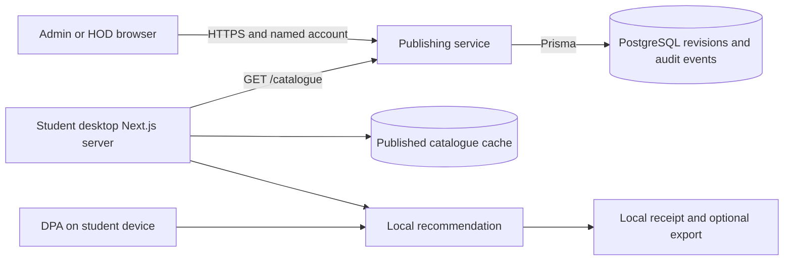

# Official planner catalogue



## Configuration

| Where | Variable | Value or purpose |
|---|---|---|
| Publishing host only | `CATALOGUE_DATABASE_URL` | `postgresql://<user>:<encoded-password>@<host>:<port>/<catalogue-db>` plus the TLS options required by your host |
| Publishing host only | `CATALOGUE_PUBLISHERS` | JSON such as `{"<publisher-login>":{"role":"HOD","hash":"<scrypt-hash>"}}`. Roles accepted for writes are Admin and HOD. Assign a separate login to each person. |
| Publishing host | `CATALOGUE_PORT` | Optional loopback listener port, default 4100 |
| Desktop or Next.js server | `PLANNER_CATALOGUE_URL` | `https://<catalogue-host>/catalogue`. HTTP is accepted on localhost for development. |
| Next.js server | `PLANNER_CACHE_DIR` | Optional writable cache directory. Electron sets a directory under userData. |
| Test process only | `CATALOGUE_TEST_URL` | Connection to a migrated disposable PostgreSQL database. Integration tests insert historical test revisions. |
| Existing app | `DATABASE_URL` | Existing local SQLite connection. Electron supplies it at launch. |

The central Prisma schema uses the PostgreSQL connector. Select the PostgreSQL-compatible hosting provider through the connection URL. SQLite has its own schema and generated client. The central service runs as a separate process and takes configuration from its environment. Keep publisher hashes and database credentials on that host.

## Local development

1. Install Node and the project dependencies with `npm ci`. Use an empty PostgreSQL database owned by a dedicated development user. With PostgreSQL installed locally, an administrator can run `createuser --pwprompt planner_dev` followed by `createdb --owner=planner_dev planner_catalogue`.
2. Set `CATALOGUE_DATABASE_URL` in the publishing terminal. Back up any database that already contains data. Run `npm run catalogue:generate`, then `npm run catalogue:migrate`. This deploys the separate catalogue migration. The migration creates revision and audit tables, one active publication per series, and a trigger protecting published content.
3. Generate a hash using the project's scrypt implementation. In PowerShell the following reads a password with a masked prompt. The command prints only the salted hash. Put it in the publisher JSON in your local process environment or secret manager.

   ```powershell
   $publisherCredential = Get-Credential -UserName '<publisher-login>' -Message 'Choose a unique catalogue password'
   $publisherCredential.GetNetworkCredential().Password | node --input-type=module -e "import {hashPassword} from './src/utils/auth/passwordHash.mjs'; let s=''; for await(const c of process.stdin)s+=c; console.log(await hashPassword(s.trimEnd()));"
   Remove-Variable publisherCredential
   ```

4. Run `npm run catalogue:start`. Open `http://localhost:4100/manage` and sign in with the named publisher account. The read endpoint is `http://localhost:4100/catalogue`.
5. In the desktop development terminal set `$env:PLANNER_CATALOGUE_URL='http://localhost:4100/catalogue'` and launch the app. Each desktop needs only the read URL. For installed Windows apps, set the user environment variable and relaunch the app from an environment that has picked up the change.

## Import local planners

1. Close the source app and make a consistent SQLite backup with SQLite's backup command or an equivalent backup tool. Keep this private on the source device, including when the database contains student records.
2. With the local and central Prisma clients generated, run `npm run catalogue:import -- prepare <private-sqlite-backup> <new-review.json>` on the source device. This reads planner definitions and writes a new file containing planner data only.
3. Review the JSON array. Select the official records, set the verified course code (for example BA-CS), confirm intake year/month and major, and supply any missing template requirements, unit categories or credits. Preserve offered terms, requisite operators, prescribed elective title markers, WIL code and equivalent codes. An intake inferred from a planner name needs HOD confirmation. Transfer only the reviewed catalogue JSON to the publishing host.
4. On the publishing host, run `npm run catalogue:import -- apply <review.json> <new-backup.json>`. The importer verifies all snapshots first, saves both central tables to a new private backup file from the same database transaction, then creates drafts. A backup write failure aborts the import. Use a fresh backup filename on each run. A duplicate or conflicting course/intake/major series is reported and skipped. Review conflicts through the revision workflow.
5. Keep normal PostgreSQL backups for disaster recovery. The import backup is a JSON record of pre-import contents. Use PostgreSQL backup/restore tooling for a full database restore.

## Publish, revise, archive and restore

Open **Manage official publications** on the Study Planners page, or visit the publishing host's `/manage` URL directly. Local Maker edits are working copies. For a planner saved in Maker, select **Export for publication** beside the local working copy. In the console choose **Load exported planner**, select that JSON file, confirm the course, major and intake, then create the draft. The same editor accepts an individual definition from the reviewed bulk import.

- **Create new series** creates version 1 for a distinct course, major and intake. The definition editor accepts the same JSON object as a single reviewed import entry.
- Select a draft, review its metadata, unit list, requirements, credits, offerings and requisites, then **Save draft**. Click **Publish draft** and confirm to make the saved definition available. Save any outstanding edits before publishing.
- For a correction, select the prior revision and click **Create revision**. Edit and publish the new draft. Publication supersedes the previous active revision in one transaction.
- **Archive** withdraws a revision from new recommendations. To restore its content, select the archived revision, create a revision and publish the resulting draft. The console retains the content and event history of older revisions. Concurrent edits are rejected with a reload message.

## Student use and audit

The desktop fetches published planners on startup, on opening Unit Suggestions, on reconnect, and at DPA comparison. BA-CS matching uses structured intake and major metadata plus transcript and mapping evidence. An active comparison uses the catalogue selected at upload. Upload again to start a comparison against a later publication.

The catalogue service receives a read request and ordinary network metadata such as the caller's IP address. DPA files, transcript rows, student names, private mappings and generated schedules stay out of the catalogue service. Local recommendations record the revision ID, name, version and generation time in browser storage under `planner-recommendation:`. The XLSX graduation assessment includes its planner identity. The HOD can compare a student's shared export with the revision in the console.

A configured desktop can use its last successful catalogue for up to 24 hours when offline. A warning identifies the cached copy. Withdrawals reach an offline student at the next successful refresh. After cache expiry the app requires a connection. A desktop with no service URL displays local-only mode and continues using its existing local planners.

## Production setup for an authorised administrator

1. Provision a dedicated PostgreSQL-compatible database and enable encrypted connections and backups. Before applying migrations to an existing catalogue, take and verify a restorable PostgreSQL backup. Use a migration identity authorised to create the tables, trigger and indexes.
2. Install the reviewed project and dependencies on the service host. Generate the central Prisma client for that host and deploy the migration as above. Run the service with a dedicated runtime database role with SELECT/INSERT/UPDATE on revisions, SELECT/INSERT on events, and sequence access. Keep schema ownership and DDL privileges with the migration role.
3. Configure named publisher credentials in a server-side secret store. Run the service under a supervised OS account. Put an HTTPS reverse proxy in front of its loopback port, forwarding `/manage`, `/revisions` and `/catalogue`. Disable request-body and Authorization-header logging. The management console uses browser HTTP Basic authentication over TLS. Close the private browser session after publishing. Rotate/revoke accounts in the server environment and restart the service. This authentication has no SSO or MFA. Rate limits are per process and count connections from the proxy together.
4. Import and approve the first catalogue. Check the public read endpoint and a student comparison on a separate machine. Distribute the URL to desktop installations. Existing desktop builds need the catalogue-enabled software once. Subsequent planner publications use the service independently of Electron releases.
5. For verification on a disposable database, migrate it with the central schema, set `CATALOGUE_TEST_URL`, then run `npm run test:catalogue`. Never point the integration test at a production catalogue.


## Implementation files

Paths are relative to the project root.

| Files | Purpose |
|---|---|
| `central/schema.prisma`, `central/migrations/202611200001_catalogue/migration.sql`, `central/migrations/migration_lock.toml`, `central/.gitignore` | Separate PostgreSQL client, additive catalogue schema, revision protection and generated-client exclusion. |
| `central/model.mjs`, `central/server.mjs`, `central/manage.html` | Definition validation, transactional lifecycle, audit events, authenticated management UI and public read API. |
| `central/import.mjs`, `src/app/libs/publicationDraft.mjs` | Prepare planner-only exports and import reviewed drafts with backups and conflict reporting. |
| `central/test.mjs` | Integration coverage using a real service, PostgreSQL and independent SQLite files and caches. |
| `electron/server.js`, `src/app/ClientLayout.jsx`, `src/middleware.js` | Per-user cache location, startup and reconnect refresh, catalogue notices and student read access. |
| `src/app/api/official-planners/route.js`, `src/app/libs/officialCatalogue.mjs` | Fetch published revisions, isolate and expire the cache, provide offline status and adapt snapshot units to the existing planning code. |
| `src/app/api/study-planner/route.js`, `src/app/libs/readLocalCatalogue.mjs` | Reuse one local definition projection for legacy installations and imports. Route configured temporary student reads to publications. |
| `src/app/view/study-planner/page.js`, `src/app/view/compare_study_planner/page.jsx`, `src/app/view/unit_suggestion/UnitPoolToolbox.js` | Access the publisher, export local definitions, match and schedule against one catalogue, record the revision and show sync status. |
| `src/app/libs/bcsPlannerRules.mjs`, `src/app/libs/plannerIntake.mjs`, `src/app/libs/doubleMajorPathway.mjs` | Use declared cohort, major and WIL metadata and planner-scoped mapping evidence. |
| `src/app/api/study-planner/validate-schedule/route.js`, `src/app/api/compare-planners/route.js`, `src/app/api/graduation-eligibility/route.js`, `src/app/api/double-major-pathway/route.js` | Validate and compare official revisions and evaluate requirement coverage. |
| `src/app/api/unit-rag/route.js`, `src/app/api/unit-replacements/route.js` | Use published unit pools when searching for replacement candidates. |
| `src/app/api/planner-assistant/route.js`, `src/app/api/planner-assistant/planning/route.js`, `src/app/libs/plannerTools.server.js` | Supply the assistant with published planner and unit data and route official edits to the publishing console. |
| `package.json`, `package-lock.json`, `README.md`, `central/README.md` | Declare schema validation dependency, expose commands and document setup and operation. |
